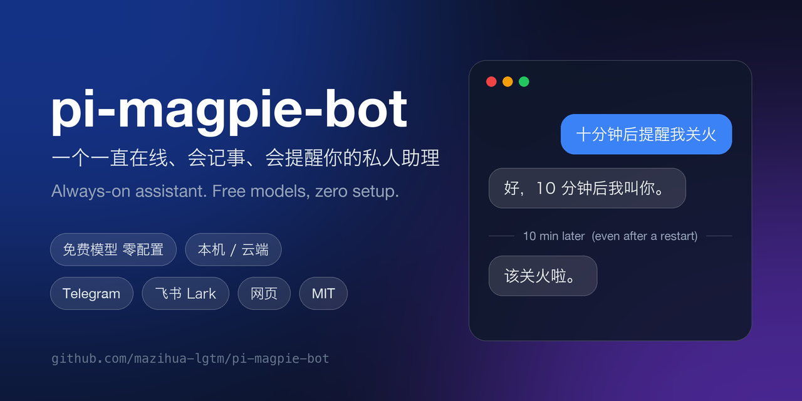
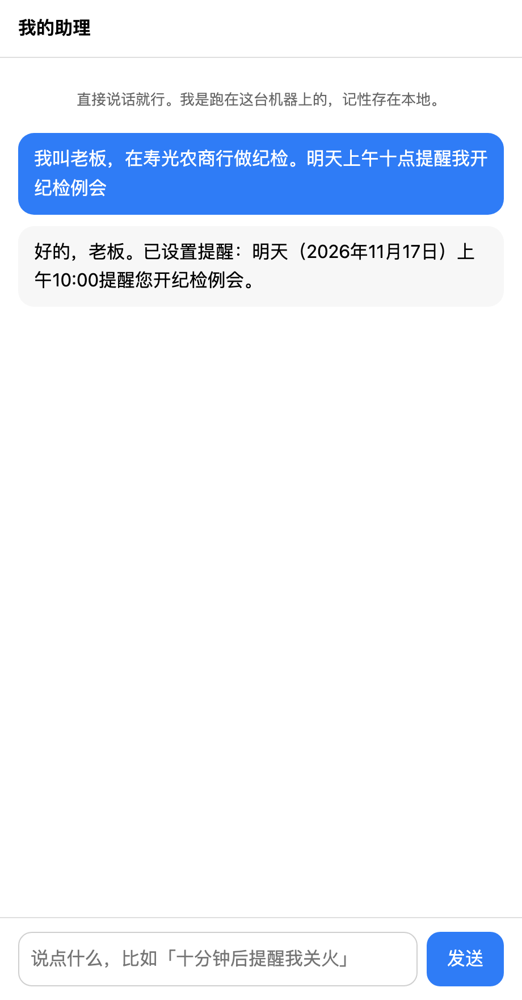

# pi-magpie-bot

<p align="center">
  
</p>

<p align="center">
  <a href="https://github.com/mazihua-lgtm/pi-magpie-bot/actions/workflows/ci.yml"></a>
  <a href="LICENSE"></a>
  <a href="https://github.com/mazihua-lgtm/pi-magpie-bot/releases"></a>
  
  
</p>

<p align="center"><a href="README.md">中文</a> · <b>English</b> · <a href="#quick-start">Quick start</a> · <a href="#telegram">Telegram</a> · <a href="#feishu--lark">Feishu</a> · <a href="#wecom-企业微信">WeCom</a> · <a href="docs/architecture.md">Architecture</a> · <a href="docs/own-models.md">Own models</a></p>

**An always-on personal assistant you run yourself.** It remembers things, keeps reminders across
restarts, and talks to you in a browser, on Telegram, on Feishu / Lark or on WeCom. It speaks through free
models out of the box: no account, no API key, no bill.

```
You: remind me to turn off the stove in ten minutes
Bot: Right — I'll shout in 10 minutes.

(ten minutes later, even if the machine has restarted)
Bot: Time to turn off the stove.
```

## Why this exists

Products like Grok Bot are good, but your conversations, memories and schedule sit on someone
else's server and you pay monthly for them. This project hands you the same pieces:

- **Free to use.** The free pool comes from [our-free-model](https://github.com/Ebony-Vinyl/dsh-our-free-model)
  through its [magpie plugin](https://github.com/mu-zi-lee/magpie-our-free-model), maintained by the
  community: no account, no key. The first start installs it, signs in and builds the `free`
  routing group; after that nobody touches it. Want more stability or a bigger model? Swap in
  your own — it is one model name.
- **Your records stay yours.** Conversations, memories and schedules are local SQLite and Markdown
  files. Copy the folder and you have migrated (what the model sees is covered under Privacy below).
- **Survives a kill.** A message is written to disk before it is handled; after a restart the work
  carries on, and nothing is answered twice. A message that was cut off mid-answer is closed and
  reported once — it does not come back as a second reply.
- **Nothing touches your machine without a yes.** Let it read your files or run a command and it
  asks first, in the chat, every time.

## Quick start

**Nothing to install first.** Open a terminal and paste one line:

```sh
curl -fsSL https://raw.githubusercontent.com/mazihua-lgtm/pi-magpie-bot/main/get.sh | bash
```

A few minutes later (a few hundred MB to download) your browser opens the chat page; just type.
Node.js and pnpm are put inside `~/.pi-magpie-bot`, nothing else on the system is touched, and the
assistant starts again by itself when you log in. macOS, Linux and Windows under WSL work (native
Windows: use Docker, below).

One command is all you need afterwards:

```sh
pi-magpie-bot status      # is it running
pi-magpie-bot logs        # read the log
pi-magpie-bot restart     # after editing .env
pi-magpie-bot update      # newest version
pi-magpie-bot uninstall   # remove it (chats and memory are kept by default)
```



**Things to try first:** "remind me to turn off the stove in ten minutes", "remember that I am
allergic to peanuts", "remind me about the meeting at 8 tomorrow", "what did I just ask you to remember?"

### Privacy in one sentence

Conversations, memories and schedules are stored on your own machine. But **every message has to
be sent to a model to get an answer**: on the free pool it passes through third-party channels
behind that pool, so do not tell it passwords or ID numbers; with your own key it goes only to the
vendor you chose.

### Manual install (for people at home in a terminal)

You need **Node.js 24 or newer** ([download](https://nodejs.org)) and pnpm.

```sh
pnpm install
pnpm start            # start it
```

The first start is the setup: with no magpie on the machine it downloads the official release
(the checksum is compared when the release publishes SHA256SUMS), installs the free-model plugin, signs in to the anonymous
pool, creates the `free` routing group, and only then connects. `./install.sh` does the same and
also writes your `.env`. Then open <http://127.0.0.1:8787>.

### Does the free pool need configuring?

No. The first start installs the plugin, signs in with its own anonymous account, builds
`group/free`, and only then connects to the gateway — the screenshot above came from exactly that
run, with nobody touching a terminal.

For more quota, or another route while the anonymous pool queues, open the plugin's own console
and attach a channel:

```sh
magpie plugin login our-free-model
```

Stop magpie first: the sign-in asks the running gateway for a management page and is refused.
The terminal prints an address — `127.0.0.1` on your own machine, a temporary `trycloudflare.com`
one on a server (neither needs an account). Open it, follow the page, restart the bot. It works
without this too.

On its first install the plugin fetches its own channel pack from `raw.githubusercontent.com`.
On a network that cannot reach it the free pool does not come up, and both the install script and
the web page say exactly that (`原渠道包下载失败`) instead of pretending it worked — there, use your
own model.

### Telegram

1. Find **@BotFather** in Telegram, `/newbot`, pick a name, keep the token.
2. `./install.sh --telegram` and paste it, or set `TELEGRAM_BOT_TOKEN=` in `.env` yourself.
3. `pnpm start`, then message your bot.

**The first account that talks to it becomes the owner**; anyone else is refused. To let more
people in, add their ids to `ALLOWED_USERS` in `.env`, comma separated. Setting it disables first-come ownership: only the list may talk, so put yourself in it.

### Feishu / Lark

No public address needed (it uses the official long connection).

1. At open.feishu.cn create a **custom enterprise app**, turn on the Bot capability, and grant
   the permissions to read private messages sent to the bot (`im:message.p2p_msg:readonly`) and
   to send messages as the app (`im:message:send_as_bot`).
2. Under event subscription choose **receive events through a long connection**, add the event
   `im.message.receive_v1`, and publish a version.
3. Put the app's App ID and App Secret in `.env` as `FEISHU_APP_ID` and `FEISHU_APP_SECRET` (for
   international Lark also set `FEISHU_DOMAIN=lark`), run `pnpm start`, wait for
   `[feishu] connected`, then message the bot in a private chat.

Private chats only; groups are ignored. As with Telegram, the first person to talk to it becomes the
owner. Text messages only for now.

### WeCom (企业微信)

No public address needed (official long connection). **This is WeCom, not personal WeChat**: only
people inside your WeCom organisation can reach it.

1. In the WeCom admin console go to Security & Management → Management Tools → Smart Bot, create
   one in API mode with the long connection, and copy its Bot ID and Secret.
2. Put them in `.env` as `WECOM_BOT_ID` and `WECOM_BOT_SECRET`, run `pnpm start`, wait for
   `[wecom] connected`, then message the bot in a private chat.

Private chats only; groups are ignored. The first person to talk to it becomes the owner. Text and
voice (the platform's own transcript) are understood; images and files get a polite "not supported".
Not yet verified against a real bot, so please open an issue if it misbehaves.

## Bring your own model

The free pool queues and has limits. For something steady, or a bigger model, there are two ways:

**Your own key** — no terminal needed: when the free pool has nothing to give, the bot puts up a
page saying what is missing, with a vendor dropdown and a key box. Paste the key, press save, and
the same process continues into the chat. To add another later, or from the command line,
`magpie provider add deepseek sk-…` (`magpie presets` lists every vendor), or open `magpie web`
(<http://127.0.0.1:3430>) and add it there.

**A local model** — start Ollama / vLLM / LM Studio on an OpenAI-compatible endpoint, then:

```sh
magpie provider add ollama url=http://127.0.0.1:11434/v1 models=qwen3:8b
```

Set `MAGPIE_MODEL=ollama/qwen3:8b` in `.env` and it is fully offline.

Every step and every trap (which models can call tools, how much context you need) is in
**[docs/own-models.md](docs/own-models.md)**, with an English summary at the end.

## Cloud

One container, everything inside:

```sh
cp .env.example .env        # fill at least WEB_PASSWORD; add Telegram etc. if you want them
docker compose up -d        # from the repo root, so .env is found
```

Open `http://<server>:8787` and enter `WEB_PASSWORD` to chat. On a phone, "add to home screen"
gives it an icon that opens full screen, like an app — nothing to install, no store involved. The bot in the container brings its
own magpie (the first start downloads it and takes a few minutes), so there is no gateway key and
no `exec` command to type. Conversations, memory, timers and magpie's keys all live in one volume
and survive a rebuild.

When no model is ready the bot does not restart in a loop: the web page explains and offers a box
to paste your own key (with signup links per vendor). On a cloud server the box **requires**
`WEB_PASSWORD` before it saves anything, and is hidden if none is set, so nobody can swap your key.

It is published to this machine only (`WEB_BIND=127.0.0.1`); to reach it from a phone or another
device, set `WEB_BIND=0.0.0.0` and always set `WEB_PASSWORD`.

To run magpie in its own container (for example several bots sharing one gateway), use
`docker compose -f compose.split.yml up -d`; the steps are at the top of that file.

> Note: the free pool is limited per egress IP, so a cloud server will most likely get nothing from
> it; bring a key or a local model. The container needs to reach github.com to fetch magpie; if it
> cannot, the log says so and the bot falls back to the page above.

## What it does

| What | How you ask | Under the hood |
| --- | --- | --- |
| Chat | just type | pi-durable sessions |
| Remember | "remember my car is a blue BYD" | Markdown under `memory/`; the index goes in every prompt, the note itself is read on demand |
| Remind | "wake me at seven tomorrow" | a `schedules` table checked every 2 seconds (`TICK_MS`), a due reminder missed while the process was down fires once on the next start |
| Long tasks | it decides | the `send_message` tool speaks first, then works |
| Read files / run commands | set `WORKSPACE_DIR` in `.env` | an approval card in the chat every time; "yes" runs it |
| Web | `pnpm start` | a built-in HTTP server, no external dependency |
| Telegram | a token in `.env` | long polling, no public IP needed |
| Feishu / Lark | App ID and Secret in `.env` | the official long connection, no public IP needed |
| WeCom | Bot ID and Secret in `.env` | the official long connection, no public IP needed; not personal WeChat |

## Configuration

`.env` (copy from `.env.example`); every line has a default:

| Variable | Default | What it does |
| --- | --- | --- |
| `MAGPIE_MODEL` | `group/free` | which model; the free pool is `group/free` |
| `MAGPIE_BASE_URL` | `http://127.0.0.1:3425` | the gateway |
| `MAGPIE_START` | `1` | `0` connects to an existing magpie instead of starting one (Docker, a remote gateway) |
| `DATA_DIR` | `~/.pi-magpie-bot` | conversations, memory, schedules |
| `TZ` | the system zone | reminders and "what time is it" use it; Docker defaults to `Asia/Shanghai` |
| `WEB_PORT` / `WEB_HOST` | `8787` / `127.0.0.1` | the chat page; `WEB_PORT=0` turns it off |
| `WEB_PASSWORD` | empty | set it and the page asks for it |
| `WEB_BIND` | `127.0.0.1` | compose only: the address the web port is published on |
| `TELEGRAM_BOT_TOKEN` | empty | set it and Telegram is connected |
| `FEISHU_APP_ID` / `FEISHU_APP_SECRET` | empty | set both and Feishu is connected |
| `FEISHU_DOMAIN` | `feishu` | `lark` for international Lark |
| `WECOM_BOT_ID` / `WECOM_BOT_SECRET` | empty | set both and WeCom is connected |
| `WORKSPACE_DIR` | empty | only with it can the bot read files and run commands (each one approved) |
| `ALLOWED_USERS` | empty | the complete list of who may talk. **Setting it disables first-come ownership**: nobody outside the list is admitted, yourself included, and the list is shared across channels |

## How it is built

Standing still for days means standing on library code. This project writes only where nothing
exists:

- **[pi-durable](https://github.com/earendil-works/pi)** — durable runs, crash recovery, retries,
  compaction, signals and sleep. The execution engine is not rewritten here.
- **[magpie](https://github.com/yetone/magpie)** — one gateway speaking the OpenAI, Anthropic and
  Gemini protocols, with routing groups that fail over between models. Changing models needs no
  code change.
- **[our-free-model](https://github.com/Ebony-Vinyl/dsh-our-free-model)** and its
  [magpie plugin](https://github.com/mu-zi-lee/magpie-our-free-model) — the anonymous free pool.
- The thin glue on top — inbox, outbox, schedules, approvals, memory directory, channel adapters —
  is this project's own, about three thousand lines across `packages/*/src`, short enough to read.

```
Telegram / Feishu / WeCom / web ──▶ inbox (dedupe, queue) ──▶ pi-durable session ──▶ outbox ──▶ you
                     ▲                            │
                     └────── schedules ───────────┘   (reminders)
```

How state is stored, who does which of the five jobs, and exactly which messages are retried after
a crash: **[docs/architecture.md](docs/architecture.md)**, with an English section at the end.

## Honest limits

- The free pool is **limited per IP**; when it is busy you queue or fail (`Our Free Model: Free
  usage limit reached` is that). `group/free` moves to the next model, but it cannot invent quota.
- When the free pool's sign-in expires or an upstream changes its API, run
  `magpie plugin login our-free-model` again (stop magpie first), or switch to your own model.
- pi-durable is marked *experimental*; its API may change between versions. This project is pinned
  to `1.5.x`.
- One process per data directory (SQLite has a single writer).
- An approval card only takes a short yes/no; anything else you type while a card is open is
  treated as a new message.
- If magpie is already installed, `install.sh` leaves it alone (no plugin, no sign-in, no server);
  add `--manage-existing-magpie` to let it add the free pool.
- Reading, writing, editing files and running commands **all need your approval**, but paths
  outside the working directory are guarded only by that card, with no sandbox: read the path
  before you approve.
- Telegram takes private chats only; group messages are ignored. With `ALLOWED_USERS` set, nobody
  can claim the bot first-come; only the listed people can use it.
- The Telegram offset advances before a message is handled: a crash mid-handling loses that one
  message (at most once, never answered twice).

## Roadmap to sustainability

This project does not charge users today, and there is one line it will not cross:
**no advertising, no business built on your data**. Memories and conversations are
yours; monetising them would kill the thing.

For now there is one job: make it free, good, and effortless, and let installs grow
on their own. The ways it can eventually pay for itself come later, not before:

- **Assistant that drives your own machine** (next): point the phone at your own
  computer or server so it stays on around the clock. Free.
- **Hosted tier** (when asked): for people who would rather not run it themselves —
  we keep the service up, back up memories and reminders, and charge monthly for
  the peace of mind, not for the model.
- **Model channel** (later, once the free pool is solid): buy capacity from one
  vendor wholesale and pass it on at cost. The free promise does not shrink because
  of it.

The first release is the Android app and one-click install. Everything else waits
until people are actually using it.

## Development

```sh
pnpm install
pnpm typecheck     # tsc --noEmit
pnpm test          # vitest
pnpm smoke         # ask the first model in the gateway one question
pnpm smoke:bot     # run the whole chain without a chat platform
```

Packages: `packages/gateway` (models), `packages/events` (host tables), `packages/memory`
(memory files), `packages/brain` (sessions and tools), `packages/channels/*` (Telegram, Feishu, WeCom, web),
`apps/bot` (the entry point).

## License

MIT. Third-party components and attribution: [NOTICE.md](NOTICE.md).
