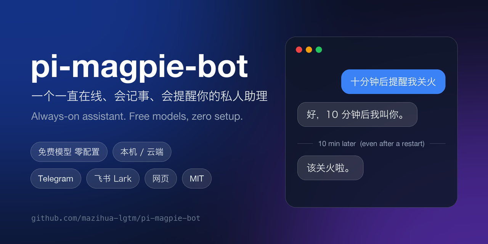
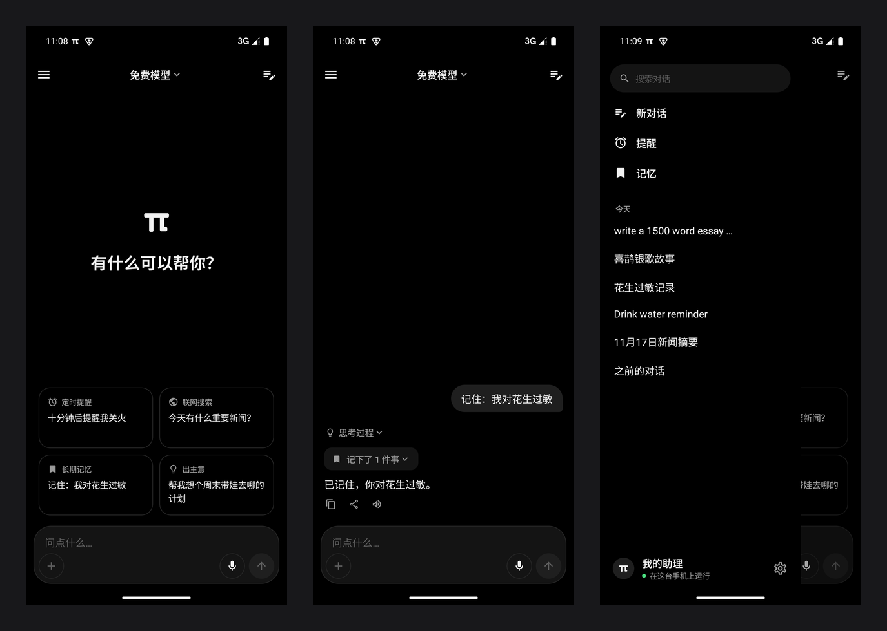
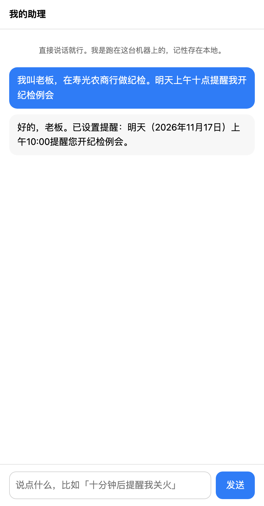

# 喜鹊 · pi-magpie-bot

<p align="center">
  
</p>

<p align="center">
  <a href="https://github.com/mazihua-lgtm/pi-magpie-bot/actions/workflows/ci.yml"></a>
  <a href="LICENSE"></a>
  <a href="https://github.com/mazihua-lgtm/pi-magpie-bot/releases"></a>
  
  
</p>

<p align="center">中文 · <b><a href="README.en.md">English</a></b> · <a href="#安卓-app--android">安卓 App</a> · <a href="#快速开始--quick-start">电脑 / 服务器</a> · <a href="#接到-telegram">Telegram</a> · <a href="docs/architecture.md">架构</a> · <a href="docs/own-models.md">自带模型</a></p>

<p align="center"><b>喜鹊一叫，事儿有着落。</b></p>

**喜鹊是一个一直在线、会记事、会提醒你、能上网查最新消息的私人助理，整只装在你自己的安卓手机里。** 也可以跑在电脑或服务器上，从浏览器或 Telegram 用。默认用免费模型开口说话：不用注册账号，不用 API key。

> 喜鹊 is an always-on personal assistant that lives in your own Android phone — memory, reminders, web search, free models out of the box (no account, no API key). It also runs on a computer or server behind a browser or Telegram.

```
你：十分钟后提醒我关火
喜鹊：好，10 分钟后我叫你。

（10 分钟后，哪怕手机刚重启过）
喜鹊：该关火啦。
```

## 为什么做这个 / Why this exists

Grok Bot 这类产品好用，但你的对话、记忆、日程都在别人服务器上，还要按月付费。这个项目把同样的东西拆开给你：

- **不要钱就能用**：免费池由 [our-free-model](https://github.com/Ebony-Vinyl/dsh-our-free-model) 提供，第一次启动自动装好、自动登录，之后就不用人管；免费池之外还有 OVH、Pollinations 两个免注册的公共端点兜底，429 时自动换路。就算本机的免费服务启动失败，也会自动只用那两个公共端点接着答，不会因为一个组件挂了就没法聊天。想更稳、想用大模型，换成自己的 key 或自己的接口就行。
- **记录在你手里**：对话、记忆、定时任务都是手机（或你自己机器）上的 SQLite 和 Markdown 文件，拷走就是迁移（模型那一头见下面的「隐私」）。
- **断电不死**：消息先落盘再处理，重启后照常接着干，不会同一句回答你两遍；真被掐断在回答一半的那条，它会主动跟你说一声「刚才那条中断了」。
- **能碰到的东西要你点头**：让它读写你的文件夹、执行命令，每次都要在聊天里回「是」。

## 安卓 App / Android

<p align="center">
  
</p>

整个助理装进一个安卓 App：模型网关、记忆、提醒都跑在手机里，不用电脑，不用服务器，不上架应用商店。界面是原生的（Jetpack Compose）：

- **多个对话**：侧栏里搜索、置顶、重命名、删除；新对话的标题由模型自己起。
- **边想边说**：回答一个字一个字出来，思考过程和它做过的事（「搜索了 4 次 · 看了 1 个网页」）折成一行，点开看细节；随时可以停。
- **能上网**：问新闻、天气、价格这类会变的事，它先搜再答（国内能用的必应），并说出处。
- **记性和提醒**：「记住……」「明早七点叫我」说一句就行；提醒页、记忆页里也能自己加、改、删。到点了锁着屏也会来通知。
- **好读**：标题、列表、代码块（一键复制）、表格都排好版；回答可以复制、分享、朗读。
- **模型随你换**：每段对话可以选不同的模型，会深度思考的模型多一个「深度思考」开关；能看图的模型可以发照片。
- **填个 key 就接大厂**：设置里选厂商贴 key，接上 DeepSeek、Kimi、通义等 8 家。
- **额度不够有去处**：免费线路排队或到量时，设置里有一页「免费额度怎么拿」：智谱、百炼、硅基流动、魔搭、Google、Groq、OpenRouter 注册就送额度，点「去注册」到官网，回来填 key 就接着用。
- **自己的接口也能接**：OpenAI 兼容的中转站、公司的私有部署、家里电脑上的 Ollama，在设置里填名字、地址、模型名和 key 就进模型列表，不用等我们收录。真不要 key 的公共端点填个 none 占位。
- **遥控电脑上的助理**：手机可以连到另一台电脑/服务器上的喜鹊，让助理 24 小时在线、用大模型，手机只管聊。在电脑网页点「配对手机」，手机扫一下就接上；两台设备在同一 WiFi 即可。详见下面的「遥控远程助理」。
- **语音输入**、深色 / 浅色 / 跟随系统。

现成的安装包在 **[Releases](https://github.com/mazihua-lgtm/pi-magpie-bot/releases)**：下载最新 APK 装上就行。第一次打开要在手机里解出运行环境（约 300 MB，几分钟），之后常驻后台；请在系统里允许它「不受省电限制」，否则手机可能为了省电把它关掉，提醒就不准时了。只支持 64 位 ARM 手机（近几年的安卓手机基本都是）。

自己打包：

```sh
pnpm install
pnpm android:payload                       # 把运行环境和这个仓库打进 assets
cd android && gradle :app:assembleRelease  # 需要 JDK 17+ 和 Android SDK
```

安装包在 `android/app/build/outputs/apk/release/`，约 100 MB。App 和手机里的助理之间走的接口写在 **[docs/app-api.md](docs/app-api.md)**。

手机操控（读屏、点按、输入）**还没做**：首版做到哪一步、哪些永远交还用户，写在 **[docs/phone-control.md](docs/phone-control.md)**。

## 快速开始 / Quick start（电脑、服务器）

**不用先装任何东西。** 打开终端（macOS：启动台里搜「终端」），粘贴这一行，回车：

```sh
curl -fsSL https://raw.githubusercontent.com/mazihua-lgtm/pi-magpie-bot/main/get.sh | bash
```

等几分钟（要下载几百 MB），浏览器会自动打开聊天页，直接打字说话。Node.js、pnpm 它自己装在 `~/.pi-magpie-bot` 里，不动系统别的东西；之后登录电脑它也会自己起来。macOS、Linux、Windows 的 WSL 都行（Windows 原生请用下面的 Docker）。

装好之后只记一个命令：

```sh
pi-magpie-bot status      # 在不在跑
pi-magpie-bot logs        # 看日志
pi-magpie-bot restart     # 重启（改了 .env 之后）
pi-magpie-bot update      # 更新到最新版
pi-magpie-bot uninstall   # 卸载（聊天记录和记忆默认留着）
```



**可以先对它说这些：**「十分钟后提醒我关火」「记住：我对花生过敏」「明天早上八点提醒我开会」「今天有什么新闻？」

### 隐私：一句话说清

对话记录、记忆、日程都存在你自己的设备上。但**每句话都要发给模型才能得到回答**：用免费池时，内容会经过免费池背后的第三方渠道，别对它说密码、证件号这类敏感内容；换成自己的 key 或自己的接口，就只发给你选的那家。

### 手动安装（会用终端的）

需要 **Node.js 24 或更新**（[下载](https://nodejs.org)）和 pnpm。

```sh
pnpm install
pnpm start            # 启动
```

第一步之后就不用人管了：本机没有 magpie 的话它会自己下载官方发布版（发布了 SHA256SUMS 时先比对再装，没有就照装），装上免费模型、建好 `free` 路由组，最后才去连网关。想连 `.env` 一起生成就改用 `./install.sh`。然后打开 <http://127.0.0.1:8787>。

### 免费池要不要配置

不用。第一次启动时 bot 自己装好、登录匿名池、建好 `group/free`——上面那张截图就是这么聊出来的，没人碰过终端。免费线路忙时它会自己换模型，429 会退避重试，不会卡死。

想要更多额度，可以打开插件自己的控制台接一个渠道：

```sh
magpie plugin login our-free-model
```

先停掉 magpie 再运行（它要问运行中的网关要管理页，会被拒）。终端会打印一个地址——本机是 `127.0.0.1` 上的页面，服务器上是临时的 `trycloudflare.com` 地址（都不用注册）；打开它按页面提示接渠道，然后重新启动 bot。不接也能用。

插件第一次安装要从 `raw.githubusercontent.com` 取它自己的渠道包。那个地址连不上的网络里免费池起不来，安装脚本和网页都会直说原因（`原渠道包下载失败`），不会假装装好了——这种网络下请直接用自己的模型。

### 接到 Telegram

1. 在 Telegram 里找 **@BotFather**，`/newbot`，起个名字，拿到一串 token。
2. `./install.sh --telegram`，把 token 粘进去；或者自己填到 `.env` 的 `TELEGRAM_BOT_TOKEN=`。
3. `pnpm start`，给你的机器人发条消息。

**第一个跟它说话的账号会成为主人**，其他人发消息会被拒绝。想多几个人用，把他们的 id 加到 `.env` 的 `ALLOWED_USERS`（逗号分隔）——注意设了它就不再自动认主人，你自己也得在名单里。

<details>
<summary><b>还能接到飞书、企业微信</b></summary>

#### 接到飞书

不需要公网地址（用官方长连接）。

1. 在 open.feishu.cn 建一个**企业自建应用**，开启「机器人」能力，加上权限「获取用户发给机器人的单聊消息」（`im:message.p2p_msg:readonly`）和「以应用身份发消息」（`im:message:send_as_bot`）。
2. 事件订阅选「**使用长连接接收事件**」，添加事件 `im.message.receive_v1`，然后发布版本。
3. 把应用的 App ID 和 App Secret 填到 `.env` 的 `FEISHU_APP_ID`、`FEISHU_APP_SECRET`（国际版 Lark 再把 `FEISHU_DOMAIN` 改成 `lark`），`pnpm start`，看到 `[feishu] connected` 就是通了，在飞书里给机器人发单聊消息。

只回单聊，群聊忽略；和 Telegram 一样，第一个跟它说话的人成为主人。目前只看得懂文字消息。

#### 接到企业微信

不需要公网地址（用官方长连接）。**这是企业微信，不是个人微信**：只有你企业微信里的同事/自己能找到它。

1. 企业微信管理后台 →「安全与管理」→「管理工具」→「智能机器人」→ 创建，选「API 模式」→「长连接」，拿到 Bot ID 和 Secret。
2. 把它们填到 `.env` 的 `WECOM_BOT_ID`、`WECOM_BOT_SECRET`，`pnpm start`，看到 `[wecom] connected` 就是通了，在企业微信里给机器人发单聊消息。

只回单聊，群聊忽略；第一个跟它说话的人成为主人。看得懂文字和语音（用平台自己的转写），图片文件会提示不支持。还没拿真实机器人验证过，遇到问题请提 issue。

</details>

## 进阶：用你自己的模型 / Bring your own model

免费池的代价是排队和限制。想稳定、想用大模型，三条路：

**自己的 key** —— 不用开终端：免费池给不出模型时，bot 自己会把「还差一步」的页面挂出来，页面上直接有厂商下拉框和一个 key 输入框，贴进去点「保存并继续」，同一个进程就接着启动、进聊天页。安卓 App 里随时在设置里加。用命令行的话，`magpie provider add deepseek sk-…`（`magpie presets` 看全部厂商），或者打开 `magpie web` 在页面里加。

**自己的接口** —— 任何 OpenAI 兼容端点：中转站、公司的私有部署、家里电脑上的模型。安卓 App 的设置里有「接入自己的接口」，填名字、地址、模型名和 key 就行；命令行：

```sh
magpie provider add 我的中转 url=https://api.example.com/v1 models=gpt-5,claude-sonnet-5-5 key=sk-…
```

**本地模型** — Ollama / vLLM / LM Studio 起一个 OpenAI 兼容端点，就是上一条：

```sh
magpie provider add ollama url=http://127.0.0.1:11434/v1 models=qwen3:8b
```

`.env` 里把 `MAGPIE_MODEL` 改成 `ollama/qwen3:8b`，就完全离线了。

每一步、每个坑（哪些模型不能调工具、上下文要多长）写在 **[docs/own-models.md](docs/own-models.md)**。

## 云端 / Cloud

一个容器，什么都在里面：

```sh
cp .env.example .env        # 至少填 WEB_PASSWORD；要接 Telegram 等再填对应几行
docker compose up -d        # 在仓库根目录跑，.env 就在旁边
```

打开 `http://<服务器地址>:8787`，输入 `WEB_PASSWORD` 就能聊天。手机浏览器里点「添加到主屏幕」，它就有图标、全屏打开，用起来跟 App 一样。容器里的 bot 自己带着 magpie（第一次启动要下载，要几分钟），没有网关密钥、没有 `exec` 命令要敲。对话、记忆、定时任务和 magpie 的 key 都在一个数据卷里，重建容器不丢。

没有可用模型时 bot 不会反复重启：网页上有一页说明，还带一个框，贴上自己的 key（页面给了各家的注册链接）就行。云端这个框**必须**先输 `WEB_PASSWORD` 才能保存，没设密码就不显示，避免被人顺手改了你的 key。

默认只发布到本机（`WEB_BIND=127.0.0.1`）；要让手机或别的设备访问，把 `WEB_BIND` 改成 `0.0.0.0`，并且一定设上 `WEB_PASSWORD`。没设密码时，网页只认本机名字（`localhost` / `127.0.0.1`）的访问，别的 Host 一律拒绝——这样恶意网页用 DNS 重绑也够不到你本机那个端口。设了密码就靠密码保护，改密码会立刻让所有已登录的浏览器和配对过的手机失效，需要重新登录。

想把 magpie 单独放一个容器（比如多个 bot 共用一个网关），用 `docker compose -f compose.split.yml up -d`，步骤写在那个文件的开头。

> 说明：免费池按出口 IP 限量，云服务器上大概率拿不到免费模型，云端请自带 key 或接自己的接口。容器里下载 magpie 要能访问 github.com，下不来时日志会直说，并退回上面那一页。

## 遥控远程助理 / Pair a remote assistant

手机不必自己在本地跑模型，可以连到另一台电脑或服务器上的喜鹊，让助理 24 小时在线、用大模型，手机只负责聊天。

先把那台电脑上的助理按「云端」或「快速开始」跑起来，**设上 `WEB_PASSWORD` 并让它监听局域网**（`WEB_HOST=0.0.0.0`；Docker 里 `WEB_BIND=0.0.0.0`）。然后：

1. 在电脑上打开喜鹊网页，登录密码，点右上角「配对手机」。
2. 屏幕上出现二维码和一个 6 位码（5 分钟有效、用一次就作废）。
3. 手机上的喜鹊 → 设置 →「助理运行位置」→「扫一扫」，对准电脑屏幕；没相机就把二维码里的链接贴进去。
4. 连上后，侧栏显示「连接到 <地址>」，聊天、记忆、提醒、审批都走远程那台；设置里可随时「断开，回到本机」。

**二维码里不含密码**，只有一个一次性配对码；手机拿它换一个绑定自己身份的登录凭据，别人拍到二维码也用不了。两台设备要在同一个 WiFi。首版只支持一对设备（一台手机 ↔ 一台助理），配对码在服务器重启后失效，需要重新扫。电脑有多个网卡、自动探测的局域网地址不对时，在 `.env` 里设 `PAIR_HOST=手机能访问的地址`。

公网或异地的手机要连，得自己给助理配上 HTTPS 或反向代理，再扫 https 的配对链接；明文 HTTP 只建议在家庭局域网用。接口细节见 **[docs/app-api.md](docs/app-api.md)**。

## 它能做什么 / What it does

| 能力 | 怎么用 | 背后是什么 |
| --- | --- | --- |
| 聊天 | 直接说 | pi-durable 的持久化会话；一台设备可以开多个对话 |
| 边想边说 | 自动 | 跟着会话的实时状态，把写到一半的回答、思考和工具步骤推给 App |
| 上网 | 「今天有什么新闻？」 | `web_search`（cn.bing.com）和 `web_fetch`，拒绝访问本机和内网地址 |
| 看图 | 在 App 里发照片 | 模型支持看图才开，图片随消息交给模型 |
| 记事 | 「记住我的车是蓝色比亚迪」 | `memory/` 下的 Markdown，索引每次进上下文，正文按需读 |
| 提醒 | 「明早七点叫我」 | `schedules` 表，进程挂了下次启动补一次 |
| 长任务先回一句 | 它自己判断 | `send_message` 工具先发后干 |
| 读写文件 / 执行命令 | 在 `.env` 设 `WORKSPACE_DIR` | 每次执行前发审批卡，回「是」才动 |
| 安卓 App | 装 APK | 手机里跑完整助理，原生界面经本机回环口说话 |
| 网页 | `pnpm start` | 内置 HTTP 服务，无外部依赖 |
| Telegram | `.env` 填 token | 长轮询，不需要公网 IP |
| 飞书 / Lark | `.env` 填 App ID 和 Secret | 官方长连接，不需要公网 IP |
| 企业微信 | `.env` 填 Bot ID 和 Secret | 官方长连接，不需要公网 IP；不是个人微信 |

## 配置 / Configuration

`.env`（从 `.env.example` 复制），全部有默认值：

| 变量 | 默认 | 作用 |
| --- | --- | --- |
| `MAGPIE_MODEL` | `group/free` | 用哪个模型；免费池是 `group/free` |
| `MAGPIE_BASE_URL` | `http://127.0.0.1:3425` | 网关地址 |
| `MAGPIE_START` | `1` | 设 `0` 就只连现成的 magpie，不自己启动（Docker/远程网关） |
| `DATA_DIR` | `~/.pi-magpie-bot` | 对话、记忆、任务都在这 |
| `TZ` | 系统时区 | 提醒和「现在几点」按它算；Docker 里默认 `Asia/Shanghai` |
| `WEB_PORT` / `WEB_HOST` | `8787` / `127.0.0.1` | 网页聊天；`WEB_PORT=0` 关掉 |
| `WEB_PASSWORD` | 空 | 设了就要密码才能进网页 |
| `WEB_BIND` | `127.0.0.1` | 仅 compose：网页端口发布到哪个地址 |
| `PAIR_HOST` | 空 | 扫码配对时二维码里的地址；留空自动探测局域网 IP，探不对就手动填 |
| `TELEGRAM_BOT_TOKEN` | 空 | 填了就接 Telegram |
| `FEISHU_APP_ID` / `FEISHU_APP_SECRET` | 空 | 两个都填了就接飞书 |
| `FEISHU_DOMAIN` | `feishu` | 国际版 Lark 填 `lark` |
| `WECOM_BOT_ID` / `WECOM_BOT_SECRET` | 空 | 两个都填了就接企业微信 |
| `WORKSPACE_DIR` | 空 | 设了才允许读写文件、执行命令（每次要审批） |
| `ALLOWED_USERS` | 空 | 允许说话的完整名单。**设了它就不再自动认主人**：名单里的人能用，名单外（包括想认主的你）一律拒绝，所以你自己也要在名单里。名单跨渠道共用，不按渠道区分 |

## 它是怎么搭的 / How it is built

站在靠谱的轮子上，这个项目只在没人做的地方写自己的代码：

- **[pi-durable](https://github.com/earendil-works/pi)** —— 持久化运行、崩溃恢复、重试、压缩、信号与休眠，全在它上面。我们不重写执行引擎。
- **[magpie](https://github.com/yetone/magpie)** —— 一个网关说 OpenAI / Anthropic / Gemini 三种协议，路由组自动在多个免费模型间切换、失败换下一个。换模型不用改一行代码。
- **[our-free-model](https://github.com/Ebony-Vinyl/dsh-our-free-model)** —— 匿名免费模型池，项目里带了一个瘦身的本地代理，负责在免费线路之间故障转移。
- 上层这层薄薄的胶水（收件箱、发件箱、定时表、审批表、记忆目录、频道适配）是这个项目自己的，`packages/*/src` 加起来三千行上下，看得完。

```
安卓 App / 网页 / Telegram ──▶ inbox（去重、排队）──▶ pi-durable 会话 ──▶ outbox ──▶ 你
                        ▲                      │
                        └── schedules ─────────┘   （定时任务）
```

数据怎么落、五件事各自归谁、断电重启后哪条消息会重来哪条不会：**[docs/architecture.md](docs/architecture.md)**。

## 已知的边界 / Honest limits

- 免费池**按 IP 限量**，忙的时候会排队或失败（`Our Free Model: Free usage limit reached` 就是这一条）；`group/free` 会自动换下一个模型，但它不能变出额度。
- 免费池的登录过期、或上游改接口时，再跑一次 `magpie plugin login our-free-model`（先停 magpie），或者换自己的模型。
- pi-durable 标着 *experimental*，升级时接口可能变；本项目钉在 `1.5.x`。
- 一个数据目录只能有一个进程在跑（SQLite 单写者）。
- 审批卡只认「是 / 否」这类短回答；开着卡的时候你说别的话，它会当作新消息。
- 本机已经装了 magpie 时，`install.sh` 不会动它（不加插件、不登录、不启动）；想让脚本把免费池加进去，加 `--manage-existing-magpie`。
- 读、写、改文件和跑命令**都要你点头**；但工作目录之外的路径只靠这张审批卡把关，没有沙箱，批之前看清路径。
- Telegram 只接私聊，群消息一律忽略；设了 `ALLOWED_USERS` 就不再「先到先得」认主人，只有名单里的人能用（你也得在名单里）。
- Telegram 的消息偏移在处理前就前进：处理中途崩溃，那一条消息会丢（最多一次，不会重复回答）。
- 安卓 App 只有 64 位 ARM 版，安装包约 100 MB，第一次打开要再解出约 300 MB；更新后助理要一两分钟才起来。看图要换能看图的模型，免费池里的模型看不了；语音输入靠手机自带的语音识别，没有就不显示麦克风。
- 上网搜索走国内版必应，搜不到或被限流时它会说搜不到，不会编。

## 以后怎么活下去 / Roadmap to sustainability

这项目现在不靠用户赚钱，而且有一条线不会越：**不碰你的数据，不放广告**。记忆和对话是你的，拿它们换钱就等于把这个项目做死了。

眼下只做一件事：把「免费、好用、不用管」做扎实，让装机量自己长起来。能活下来的路子放在后面，不急着收钱：

- **遥控自己机器的助理**（已完成）：手机扫码连上你自己的电脑或服务器，让助理 24 小时在线。功能免费。
- **托管版**（等有人要）：不想自己维护的人，让我们替他跑常驻服务、备份记忆和提醒、保证在线，按月付费买的是「省心」，不是模型本身。
- **模型通道**（更后面）：免费池稳了、有了量之后，跟一家模型方谈个批发价，做「充一点用很久」的内部通道。免费承诺不会因为这条而缩水。

安卓 App 和一键安装已经有了，其余的等用户用出来再说。

## 开发 / Development

```sh
pnpm install
pnpm typecheck     # tsc --noEmit
pnpm test          # vitest
pnpm smoke         # 直接问一遍网关里的第一个模型
pnpm smoke:bot     # 不用聊天平台，跑一遍完整链路
```

目录：`packages/gateway`（模型）、`packages/events`（宿主表）、`packages/memory`（记忆文件）、`packages/brain`（会话与工具）、`packages/channels/*`（网页与 App 接口、Telegram、飞书、企业微信）、`apps/bot`（入口）、`android/`（安卓 App）。

## 许可 / License

MIT。第三方组件与出处见 [NOTICE.md](NOTICE.md)。

---

**English.** A full English README, one to one with this one, is at **[README.en.md](README.en.md)**.
